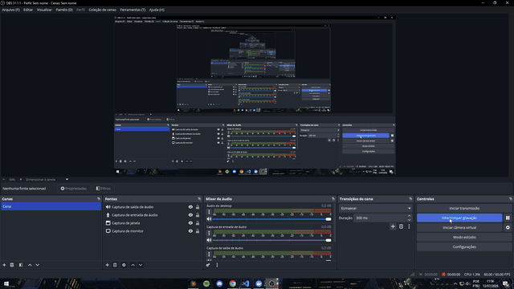

# NeuroSight

Sistema de rastreamento ocular com **Meta Quest Pro**: um app VR (Unreal Engine 5.5) grava
para onde a pessoa está olhando dentro de um ambiente 3D e, ao fim da sessão, envia tudo para
um ambiente web, onde cada sessão pode ser assistida **com ou sem heatmap do olhar**.



🎥 [Vídeo completo da demonstração (1 min, MP4)](docs/demo-ambiente-web.mp4)

## Como funciona

```
[Quest Pro — quest-app/]                              [Servidor — web/backend]  [Navegador — web/frontend]
 OpenXR: raio do olhar (~72–90 Hz)                     API FastAPI               React + Vite
 ├─ raycast → ponto 3D olhado                          ├─ banco de dados         ├─ lista de sessões
 ├─ captura de vídeo da cena (30 fps, 1024²)           ├─ monta o MP4            ├─ vídeo + heatmap
 └─ botão B → envia JSON + frames ───── HTTP ────►     └─ mídia em disco         └─ modo validação
```

## Estrutura do repositório

| Pasta | O que é |
|---|---|
| [`quest-app/`](quest-app/) | App VR para o Quest Pro (UE 5.5): gaze → raycast → captura → `gaze.json` → upload. Veja o [README](quest-app/README.md) e o [passo a passo](quest-app/PASSO-A-PASSO.md). |
| [`web/`](web/) | Ambiente web: API (FastAPI + SQLAlchemy) em `backend/` e site (React + Vite + TS) em `frontend/`. Veja o [README](web/README.md) e o [DEPLOY.md](web/DEPLOY.md). |
| [`docs/`](docs/) | Demonstração (GIF e MP4) e o [relatório final de IC](docs/IC-RelatorioFinal/). |

## Começar

- **App VR:** siga [`quest-app/README.md`](quest-app/README.md) (setup resumido) ou
  [`quest-app/PASSO-A-PASSO.md`](quest-app/PASSO-A-PASSO.md) (guia do zero).
- **Ambiente web em desenvolvimento:** siga
  [`web/README.md`](web/README.md#rodar-em-desenvolvimento-sem-instalar-banco); dá para testar
  sem o óculos com uma sessão sintética ou reenviando uma sessão real.
- **Produção:** [`web/DEPLOY.md`](web/DEPLOY.md) (Docker Compose).

## Origem

Este repositório unifica os antigos repositórios `QuestPro-EyeTracking` (app VR) e
`QuestPro-EyeTracking-Web` (ambiente web), com o histórico de commits de ambos preservado.
